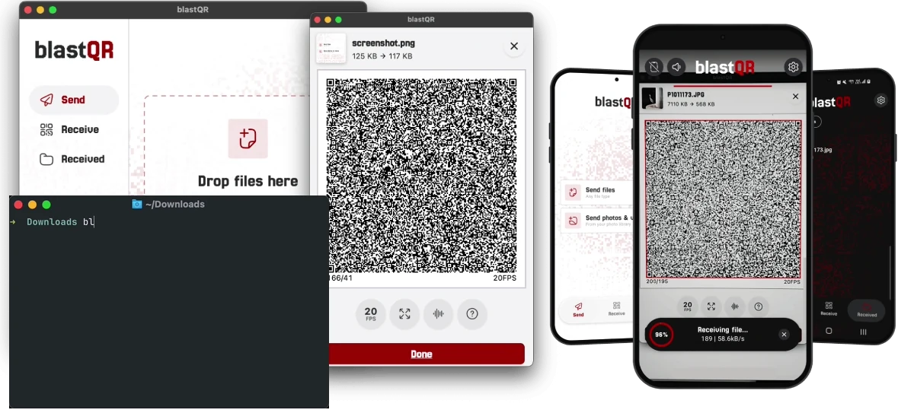

<p align="center"></p>
<h3 align="center">Easy offline file transfers over QR codes</h3>
<p align="center">

</p>

<p align="center">
<a href="https://f-droid.org/packages/dev.blastapps.blastqr"></a>
<a href="https://apps.obtainium.imranr.dev/redirect?r=obtainium://add/https://github.com/cu-kha/blastqr"></a>
<a href="https://play.google.com/store/apps/details?id=dev.blastapps.blastqr"></a>
<a href="https://apps.apple.com/app/id6831422458"></a>
</p>

## Introduction

blastQR is an open-source file transfer app and protocol that works completely offline. Data is transferred through sequences of QR codes displayed on a sender device and scanned by a receiver device's camera.

When using compression and displaying multiple codes, it's fast enough for simple everyday picture and file transfers. It's also especially useful for air-gapped systems (computers that are completely cut off from any network). Transfers can optionally be encrypted with a password to prevent interception.

The protocol is an open spec so that other software can freely add support for sending and receiving blastQR transfers.

Written in Flutter and Rust and currently available for Linux, Android, iOS, macOS and Windows.

## Downloads

| Platform | App | Command-line tool |
|---|---|---|
| Android | [F-Droid](https://f-droid.org/packages/dev.blastapps.blastqr), [APK](https://github.com/cu-kha/blastqr/releases/latest), [Google Play](https://play.google.com/store/apps/details?id=dev.blastapps.blastqr) | |
| iOS | [App Store](https://apps.apple.com/app/id6831422458) | |
| macOS | [DMG](https://github.com/cu-kha/blastqr/releases/latest), [App Store](https://apps.apple.com/app/id6831422458) | [Homebrew](#command-line-tool) |
| Linux | [Flatpak](https://github.com/cu-kha/blastqr/releases/latest), [Tarball](https://github.com/cu-kha/blastqr/releases/latest) | [Homebrew](#command-line-tool), [Binary](https://github.com/cu-kha/blastqr/releases/latest) |
| Windows | [Installer](https://github.com/cu-kha/blastqr/releases/latest) | [Binary](https://github.com/cu-kha/blastqr/releases/latest) |

Windows can only send for now, because the app has no camera support there.

## Features

<!-- TODO: video -->

- **Works fully offline:** No internet, Wi-Fi, Bluetooth or servers. The only link between devices is the screen and the camera. Your data stays offline.
- **Runs everywhere:** Android, iOS, macOS, Linux and Windows, plus a command-line tool that can send from a terminal, even over SSH.
- **Multiple codes on screen:** Shows up to 6 QR codes at once for higher speed. With 6 codes at 30 fps, transfers peak at around 500 kB/s.
- **Send multiple files in one go:** They're zipped into one transfer and unpacked into separate files on the receiver.
- **Sound feedback:** The receiver plays a short tone when it has the whole file, and the sender stops automatically when it hears it.
- **Password encryption:** You can optionally encrypt files with an auto-generated password or a custom one.
- **File compression:** The app supports lossy and lossless compression of images and files (gzip) for quicker transfers.
- **No need to catch every code:** Start scanning at any point and keep the camera on the screen until it's done. Blurry or missed codes don't matter.
- **Regular QR scanner:** You can also scan normal QR codes and save them.

## Real-world benchmarks

| Codes on screen | Sender FPS | iPhone 17 | Galaxy S22 | Galaxy S10e |
|:-:|:-:|--:|--:|--:|
| 1 | 25 | 64 kB/s · 41.9 s | 59 kB/s · 45.3 s | 65 kB/s · 40.5 s |
| 1 | 30 | 75 kB/s · 35.3 s | 88 kB/s · 30.3 s | 80 kB/s · 33.3 s |
| 1 | 60 | 173 kB/s · 15.3 s | – | – |
| 2 | 25 | – | – | 119 kB/s · 22.3 s |
| 2 | 30 | 174 kB/s · 15.2 s | 169 kB/s · 15.7 s | 113 kB/s · 23.6 s |
| 2 | 60 | 284 kB/s · 9.3 s | – | – |
| 6 | 25 | 384 kB/s · 6.9 s | 222 kB/s · 11.9 s | 172 kB/s · 15.4 s |
| 6 | 30 | **526 kB/s · 5.0 s** | **364 kB/s · 7.3 s** | – |

Each test sent a 2.6 MB file and each result is the best of 4 attempts. The camera preview ran at 60 fps on the iPhone and 30 fps on the Samsung phones.

## Command-line tool

The `blastqr` command-line tool is a small Rust program that sends files from a terminal. It shows the QR code sequence in the terminal window, and you scan it with the app. Receiving is not supported.

> [!NOTE]
> Most terminals draw the codes with simple Unicode characters, which limits speed a lot, so only small files are practical there. Alternatives like Kitty, Ghostty, iTerm2 and WezTerm can draw much denser codes as images at high frame rates, reaching speeds similar to the app.

Install it with [Homebrew](https://brew.sh):

```sh
brew install cu-kha/tap/blastqr
```

Then send one or more files:

```sh
blastqr report.pdf
blastqr photos/*            # several files
blastqr -e secrets.txt      # encrypt with a generated password
blastqr -c 4 --fps 30 a.zip # 4 codes at once, 30 frames per second
pbpaste | blastqr           # send the clipboard (macOS)
pg_dump mydb | blastqr --name mydb.sql
blastqr -                   # type or paste text, then Ctrl-D
```

While it runs, ↑/↓ change the speed and q quits. With `-e`, space shows the hidden password for 10 seconds.
Run `blastqr --help` for all options, or see [cli/README.md](cli/README.md).

## Encryption

Without encryption, anyone who can see or record the QR codes can read the file.

With "Send password-encrypted" in the app, or `blastqr -e`, the file and its name are encrypted, and a recording of the codes is useless without the password.

> [!WARNING]
> - Don't show the password where a camera could record it.
> - A weak custom password can be guessed from a recording.
> - Encryption only protects the transfer. Once received, the file is saved decrypted like any other file.
> - Information about the file size is currently not encrypted and can be seen.

Files are encrypted with ChaCha20-Poly1305, and the key is derived from the password with Argon2id. Generated passwords are 12 random [Crockford Base32](https://www.crockford.com/base32.html) characters (60 bits), like `7K3M-Q9TX-2HVD`.

## Protocol

The transfer format is documented in [docs/protocol.md](docs/protocol.md).

## Building from source

You need:

- [Flutter](https://docs.flutter.dev/get-started/install) (stable channel, Flutter 3.41 / Dart 3.11 or newer)
- [Rust](https://www.rust-lang.org/tools/install) installed with rustup, which builds the RaptorQ and encryption libraries. The targets for your platform are installed automatically from `rust-toolchain.toml`.
- The usual platform tools: Xcode for iOS/macOS, Android Studio or the Android SDK for Android. Android also needs NDK 27 or newer.
- On Linux, the GStreamer development packages for the camera (`libgstreamer1.0-dev libgstreamer-plugins-base1.0-dev gstreamer1.0-plugins-good` on Ubuntu/Debian).

```sh
git clone https://codeberg.org/cukha/blastqr.git
cd blastqr
flutter pub get
flutter run
```

RaptorQ comes from the [raptorq_flutter](https://pub.dev/packages/raptorq_flutter) package, and encryption from [packages/blastqr_envelope/](packages/blastqr_envelope/). Both are built automatically.

`flutter test` runs the tests. It builds the native libraries for your computer first, which takes a while the first time.

## Translations

The app is available in:

- Arabic
- Catalan
- English
- Korean
- Spanish

Translations are standard Flutter `.arb` files in `lib/l10n/`. To add a language, copy `app_en.arb`, translate the values and run `flutter gen-l10n` (or just `flutter run`). Pull requests with fixes or new languages are very welcome.

## AI use disclosure

I started this project in 2025 as a tool for my own use, and the core of it was written without AI. Later I used Claude Code to improve it a lot and get it to a state where I'm happy to make it public.

I don't consider the app "vibe coded", and I plan to keep developing it together with the open-source community. The exception is the command-line tool, which was largely written by AI, since I don't have much experience building command-line tools.

## License

blastQR is licensed under the [GNU Affero General Public License v3.0](LICENSE) or any later version.

Bundled third-party components keep their own licenses:

- [Jersey 25](https://github.com/scfried/soft-type-jersey) font, SIL Open Font License 1.1 ([fonts/Jersey25/OFL.txt](fonts/Jersey25/OFL.txt))
- [raptorq](https://github.com/cberner/raptorq) crate, Apache License 2.0 ([assets/licenses/raptorq.txt](assets/licenses/raptorq.txt))
- [argon2](https://github.com/RustCrypto/password-hashes) and [chacha20poly1305](https://github.com/RustCrypto/AEADs) crates, MIT or Apache License 2.0

## Acknowledgments

- [raptorq](https://github.com/cberner/raptorq), the RaptorQ implementation
- [zxing-cpp](https://github.com/zxing-cpp/zxing-cpp) and [flutter_zxing](https://github.com/khoren93/flutter_zxing) for QR scanning
- [RustCrypto](https://github.com/RustCrypto) for Argon2id and ChaCha20-Poly1305
- [flutter_soloud](https://github.com/alnitak/flutter_soloud) and [record](https://github.com/llfbandit/record) for the completion tone
- [flutter_rust_bridge](https://github.com/fzyzcjy/flutter_rust_bridge)

## Similar projects

- [txqr](https://github.com/divan/txqr): data transfer over animated QR codes
- [libcimbar](https://github.com/sz3/libcimbar): high-density color barcodes for file transfer
- [qrs](https://github.com/qifi-dev/qrs): Stream data through multiple QRCodes 
- [decimen](https://github.com/bashalarmistalt/decimen-optical-transfer): fountain-coded QR file transfer

## Why another QR code file transfer project?

Sending files over QR codes isn't a new idea, but most of the tools I tried were web apps hosted on a server, which defeats the point of a truly offline, air-gapped transfer. blastQR is a native app that runs entirely on your device. It also adds password encryption and a completion tone that stops the sender automatically, neither of which I'd seen elsewhere.
