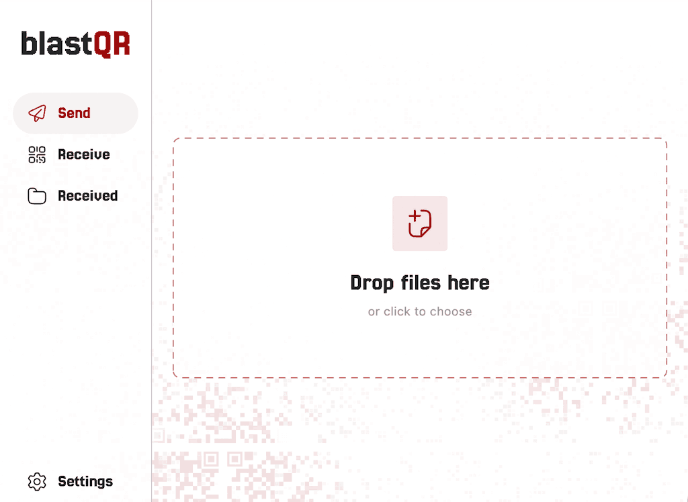

# blastQR

blastQR is an open-source file transfer app and protocol that works completely offline. Data is transferred through sequences of QR codes displayed on a sender device and scanned by a receiver device's camera. Typical transfer speeds reach around 60 kB/s and can go much higher when displaying multiple codes or increasing the frame rate, if the devices can handle it.

It works for everyday transfers, and it's especially useful for air-gapped systems (computers that are completely cut off from any network). Transfers can optionally be encrypted with a password to prevent interception.

The protocol is an open spec so that other software can freely add support for sending and receiving blastQR transfers.

The app is written in Flutter and Rust and currently available for Linux, Android, iOS, macOS and Windows. There is also a command-line tool built in Rust for easy sending of files from the terminal.



## Get it

| Platform | Send | Receive | App | Command-line tool |
|---|:-:|:-:|---|---|
| Android | ✓ | ✓ | <!-- TODO: link --> | |
| iOS | ✓ | ✓ | <!-- TODO: link --> | |
| macOS | ✓ | ✓ | <!-- TODO: link --> | [Homebrew](#command-line-tool) |
| Linux | ✓ | ✓ | [Flatpak](#linux) | [Homebrew](#command-line-tool) |
| Windows | ✓ | | <!-- TODO: link --> | [`.zip`](https://github.com/cu-kha/blastqr/releases/latest) |

Windows can't receive yet because the app has no camera support there.

### Linux

Download the `.flatpak` file for your computer from the [latest release](https://github.com/cu-kha/blastqr/releases/latest), then install it:

```sh
flatpak install blastqr-*-linux-x64.flatpak
```

## Features

<!-- TODO: video -->

- **Works fully offline.** The only link between devices is the screen and the camera.
- **Resilient to missed frames.** Files are encoded with [RaptorQ](https://en.wikipedia.org/wiki/Raptor_code), a fountain code, so the receiver can rebuild the file from any large enough set of frames, in any order.
- **Multiple codes on screen.** Shows up to 6 QR codes at once for higher speed. With 6 codes at 30 fps, transfers peak at around 500 kB/s.
- **Completion signal by sound.** When the receiver has the whole file it plays a short tone, and the sender's microphone picks it up to stop the transfer.
- **Several files at once.** They're zipped into one transfer and unpacked into separate files on the receiver.
- **Optional password encryption.** The sender gets a generated password to share with the receiver, who types it in once the file has arrived.
- **Optional image compression and gzip** to shrink files before sending.
- **Regular QR scanner.** Normal QR codes are shown as text.

## Command-line tool

`cli/` has a small Rust program that sends files from a terminal. It shows the QR codes in the terminal window, and you scan them with the app. It only sends; receiving needs the app.

Install it with [Homebrew](https://brew.sh):

```sh
brew install cu-kha/tap/blastqr
```

Then send one or more files:

```sh
blastqr report.pdf
blastqr photos/*            # several files go as one zip
blastqr -e secrets.txt      # encrypt with a generated password
blastqr -c 4 --fps 30 a.zip # 4 codes at once, 30 frames per second
```

While it runs, ↑/↓ change the speed, space pauses and q quits.

In Kitty, Ghostty, iTerm2 and WezTerm the codes are drawn as images. Other terminals draw them with Unicode block characters, which can't fit the densest codes, so transfers are slower there. Run `blastqr --help` for all options, or see [cli/README.md](cli/README.md).

## Encryption

Without encryption, anyone who can see or record the QR codes can read the file.

With "Send password-encrypted" in the app, or `blastqr -e`, the file and its name are encrypted, and a recording of the codes is useless without the password.

Some things to keep in mind:
- Don't show the password where a camera could record it.
- The size of the file can still be seen.
- A weak custom password can be guessed from a recording.
- Received files are saved unencrypted on the receiving device.

Files are encrypted with ChaCha20-Poly1305, and the key is derived from the password with Argon2id. Generated passwords are 12 random [Crockford Base32](https://www.crockford.com/base32.html) characters (60 bits), like `7K3M-Q9TX-2HVD`.

## Protocol

The transfer format is documented in [docs/protocol.md](docs/protocol.md).

## Building from source

You need:

- [Flutter](https://docs.flutter.dev/get-started/install) (stable channel, Flutter 3.41 / Dart 3.11 or newer)
- [Rust](https://www.rust-lang.org/tools/install) installed with rustup, which builds the RaptorQ and encryption libraries. The targets for your platform are installed automatically from `rust-toolchain.toml`.
- The usual platform tools: Xcode for iOS/macOS, Android Studio or the Android SDK for Android. Android also needs NDK 27 or newer.
- On Linux, the GStreamer development packages for the camera (`libgstreamer1.0-dev libgstreamer-plugins-base1.0-dev gstreamer1.0-plugins-good` on Ubuntu/Debian).

```sh
git clone https://codeberg.org/cukha/blastqr.git
cd blastqr
flutter pub get
flutter run
```

RaptorQ comes from the [raptorq_flutter](https://pub.dev/packages/raptorq_flutter) package, and encryption from [packages/blastqr_envelope/](packages/blastqr_envelope/). Both are built automatically.

`flutter test` runs the tests. It builds the native libraries for your computer first, which takes a while the first time.

## Translations

The app is available in:

- Arabic
- Catalan
- English
- Korean
- Spanish

Translations are standard Flutter `.arb` files in `lib/l10n/`. To add a language, copy `app_en.arb`, translate the values and run `flutter gen-l10n` (or just `flutter run`). Pull requests with fixes or new languages are very welcome.

## AI use disclosure

I started this project in 2025 as a tool for my own use, and the core of it was written without AI. Later I used Claude Code to improve it a lot and get it to a state where I'm happy to make it public.

I don't consider the app "vibe coded", and I plan to keep developing it together with the open-source community. The exception is the command-line tool, which was largely written by AI, since I don't have much experience building command-line tools.

## License

blastQR is licensed under the [GNU Affero General Public License v3.0](LICENSE) or any later version.

Bundled third-party components keep their own licenses:

- [Jersey 25](https://github.com/scfried/soft-type-jersey) font, SIL Open Font License 1.1 ([fonts/Jersey25/OFL.txt](fonts/Jersey25/OFL.txt))
- [raptorq](https://github.com/cberner/raptorq) crate, Apache License 2.0 ([assets/licenses/raptorq.txt](assets/licenses/raptorq.txt))
- [argon2](https://github.com/RustCrypto/password-hashes) and [chacha20poly1305](https://github.com/RustCrypto/AEADs) crates, MIT or Apache License 2.0

## Acknowledgments

- [raptorq](https://github.com/cberner/raptorq), the RaptorQ implementation
- [zxing-cpp](https://github.com/zxing-cpp/zxing-cpp) and [flutter_zxing](https://github.com/khoren93/flutter_zxing) for QR scanning
- [RustCrypto](https://github.com/RustCrypto) for Argon2id and ChaCha20-Poly1305
- [flutter_soloud](https://github.com/alnitak/flutter_soloud) and [record](https://github.com/llfbandit/record) for the completion tone
- [flutter_rust_bridge](https://github.com/fzyzcjy/flutter_rust_bridge)

## Similar projects

- [txqr](https://github.com/divan/txqr): data transfer over animated QR codes
- [libcimbar](https://github.com/sz3/libcimbar): high-density color barcodes for file transfer
