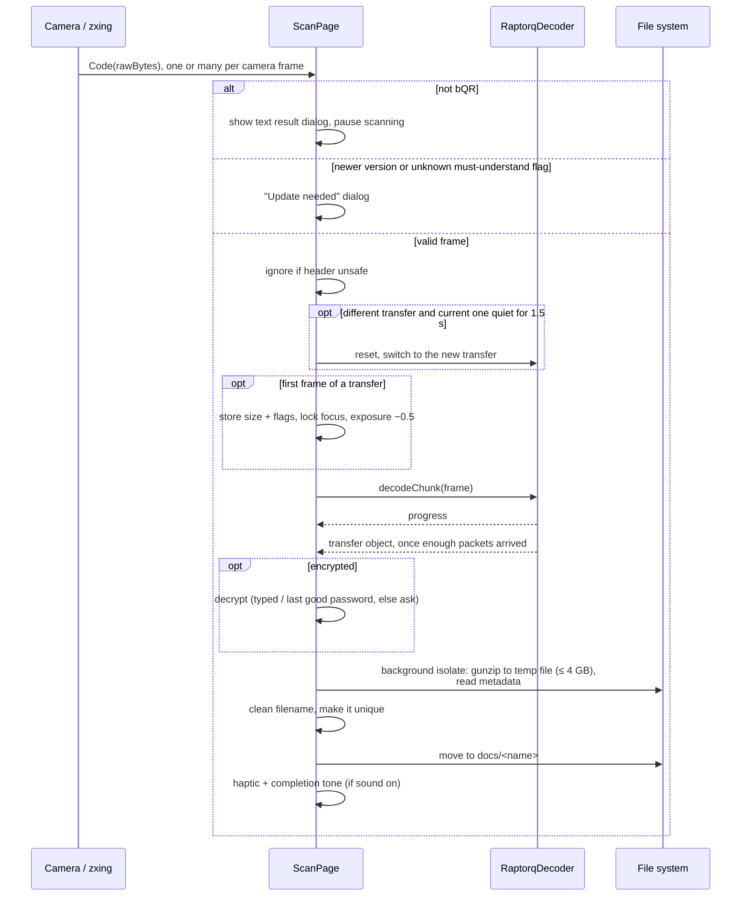

# BlastQR transfer protocol (v2)

How BlastQR moves a file from one screen to another device's camera, as
currently implemented. Protocol version **2** is the only supported version as of today.

| Concern | File |
|---|---|
| Frame header, parsing, limits | [lib/model/blast_qrcode_data.dart](../lib/model/blast_qrcode_data.dart) |
| Transfer object (metadata + content) | [lib/model/transfer_container.dart](../lib/model/transfer_container.dart) |
| Preparing the payload, rendering frames | [lib/features/send/helpers/file_qr_encoder.dart](../lib/features/send/helpers/file_qr_encoder.dart) |
| Endless RaptorQ packet stream | [lib/raptorq/raptorq_streaming_encoder.dart](../lib/raptorq/raptorq_streaming_encoder.dart) |
| Playback (timing, grid) | [lib/features/send/widgets/raptorq_qr_streaming_widget.dart](../lib/features/send/widgets/raptorq_qr_streaming_widget.dart) |
| Receiving | [lib/features/scan/scan_page.dart](../lib/features/scan/scan_page.dart), [lib/features/scan/transfer_tracker.dart](../lib/features/scan/transfer_tracker.dart), [lib/raptorq/raptorq_decoder.dart](../lib/raptorq/raptorq_decoder.dart) |
| Saving | [lib/features/scan/received_file_writer.dart](../lib/features/scan/received_file_writer.dart), [lib/file_name_utils.dart](../lib/file_name_utils.dart) |
| Completion tone | [lib/sound_feedback.dart](../lib/sound_feedback.dart), [lib/acoustic_ack_listener.dart](../lib/acoustic_ack_listener.dart) |
| RaptorQ bindings | `../raptorq_flutter` (Rust crate `raptorq` 1.8.1) |
| Encryption | [lib/crypto/](../lib/crypto/) (passwords, wrapper), `../blastqr_crypto` (Rust: `argon2`, `chacha20poly1305`) |

---

## 1. Overview

The link is **one-way**: the sender shows QR codes, the receiver's camera reads
them, and the receiver can't ask for a missed frame. So the sender uses
**RaptorQ**, a fountain code: the file is split into K source packets, and the
sender can generate an unlimited number of extra *repair* packets. Any ~K
distinct packets rebuild the file, in any order. Missed frames cost time, never
correctness.

The sender shows each packet once, in its own QR code, and never repeats one.
Every frame a receiver catches is new information, however many it has missed.

```mermaid
flowchart LR
    subgraph Sender
        A[File bytes] --> B[Optional image re-encode]
        B --> C[Prepend metadata block<br/>with filename]
        C --> D[gzip if it helps]
        D --> D2[Encrypt with password<br/>optional]
        D2 --> E[RaptorQ: K source packets,<br/>then new repair packets forever]
        E --> F[Add 14-byte header<br/>to each packet]
        F --> G[Render on demand<br/>QR v≤40, ECC L, mask 3]
        G --> H[Show each frame once<br/>1–6 codes, staggered]
    end
    H -. light .-> I
    subgraph Receiver
        I[Camera + zxing multi-scan] --> J{Starts with bQR?}
        J -- no --> K[Show as plain QR text]
        J -- yes --> L[Parse header,<br/>check version + flags]
        L -- too new --> U[Ask to update the app]
        L --> V{Safe header and<br/>same transfer?}
        V -- no --> I
        V -- yes --> M[RaptorQ decoder]
        M -- not yet --> I
        M -- done --> M2[Decrypt if encrypted<br/>ask for password]
        M2 --> N[gunzip to temp file,<br/>≤ 4 GB]
        N --> O[Clean filename]
        O --> P[Move to docs/]
        P --> Q[Play 880→1320 Hz tone]
    end
    Q -. sound .-> R[Sender mic hears tone<br/>→ shows 'completed']
```



---

## 2. Wire format

### 2.1 Frame (one QR code)

Each QR code holds a 14-byte header followed by one RaptorQ packet:

```
offset  size  field            notes
──────  ────  ───────────────  ─────────────────────────────────────────────
0       3     signature        "bQR" = 0x62 0x51 0x52
3       1     version          2
4       1     flags            see below
5       1     kind             what is being sent (0 = file)
6       2     sessionId        u16 BE, random (1–65535) per send
8       4     transferLength   u32 BE, size L of the transfer object (2.3)
12      2     symbolSize       u16 BE, RaptorQ symbol size T
14      4+T   RaptorQ packet   see 2.2
```

```
 0        3   4   5   6        8                12       14
 ┌────────┬───┬───┬───┬────────┬────────────────┬────────┬──────────────────────────┐
 │ b Q R  │ v │ f │ k │session │ transferLength │   T    │ SBN|ESI| symbol (T bytes) │
 └────────┴───┴───┴───┴────────┴────────────────┴────────┴──────────────────────────┘
   └──────────────────── 14-byte header ──────────────────┘ └──── RaptorQ packet ────┘
```

A frame is always exactly `14 + 4 + T` bytes. At the default MTU (T = 2928)
that's **2946 bytes**, just under the 2953-byte limit of QR version 40 at
error-correction level L. All integers are big-endian.

**Signature and version.** `bQR` identifies BlastQR frames. Future versions
keep the signature and increase `version`, so a receiver can always tell
"BlastQR, but too new" (ask to update) from "not BlastQR" (show as plain QR).

**Flags.** The low half must be understood; the high half can be ignored.

| bit | name | half | meaning |
|---|---|---|---|
| 0x01 | gzip | must understand | the transfer object is gzipped |
| 0x02 | encrypted | must understand | the transfer object is an encrypted envelope (2.5) |
| 0x04, 0x08 | — | must understand | free |
| 0x10–0x80 | — | safe to ignore | free, for optional hints |

A receiver that sees an unknown *must understand* bit refuses the stream and
asks the user to update. Unknown *safe to ignore* bits are ignored.

**Kind.** What is being sent, so the receiver can show a fitting UI while the
transfer is still running. Only `0` (file) is used today. Unknown kinds are
received as plain files, so new kinds never break older apps.

**Session id.** New for every send. Together with the other fixed header fields
it identifies one transfer (the *stream key*, see 4.3).

**Symbol size.** Lets the receiver build the decoder without guessing, and
check that the frame is exactly one header plus one packet.

### 2.2 RaptorQ packet

```
┌─────┬──────────────┬─────────────────────────────┐
│ SBN │ ESI          │ symbol data                 │
│ u8  │ u24 BE       │ T bytes                     │
└─────┴──────────────┴─────────────────────────────┘
  SBN = source block number, ESI = encoding symbol id
  (ESI < K_block → source symbol, otherwise repair symbol)
```

Both sides use the `raptorq` crate's default parameters
(`ObjectTransmissionInformation::with_defaults(L, T)`), so the receiver derives
the same block split from `transferLength` and `symbolSize`:

- **Symbol size T** = the sender's MTU setting rounded down to a multiple of 8
  (2935 → 2928). MTU range is 100–2935, so T is 96–2928.
- **Source blocks:** the crate splits large transfers into blocks of at most
  56,403 symbols (~165 MB at T = 2928, ~5.4 MB at T = 96).

### 2.3 Transfer object

What RaptorQ carries: a metadata block followed by the file content, optionally
gzipped as a whole.

```
┌──────────────┬──────────────────────────────────────┬──────────────────┐
│ metadata len │ metadata entries                     │ file content     │
│ u16 BE (M)   │ M bytes: u8 tag · u16 BE len · value │                  │
└──────────────┴──────────────────────────────────────┴──────────────────┘
        │
        ▼  gzip, if flag 0x01 (applied only when it makes the data smaller)
┌──────────────────────────────────────────────────────────────────────────┐
│ transfer object, length L = transferLength                               │
└──────────────────────────────────────────────────────────────────────────┘
```

If flag 0x02 is set, the whole result (after gzip) is wrapped in an
encrypted envelope (2.5), and `transferLength` is the envelope's length.

Metadata tags:

| tag | value |
|---|---|
| 1 | filename including extension, UTF-8, at most 255 bytes |

Receivers skip unknown tags, so new metadata (e.g. a MIME type) can be added
without a new version.

Everything private (filename, metadata, content) is inside the transfer object.
The frame header only describes how to decode it.

### 2.4 Limits

| limit | value | enforced by |
|---|---|---|
| File content | ~4 GB (`maxFileBytes` = 2³² − 1 − 1024) | sender refuses; receiver stops writing past it |
| Symbols per transfer | 1,500,000 (`maxSymbolCount`) | sender refuses; receiver ignores the frames |
| Symbol size | ≥ 64 and a multiple of 8 | receiver ignores other frames |
| Metadata block | ≤ 1024 bytes reserved | sender |

Encryption adds 52 bytes, which fits in the reserved metadata room, so the
sender's size checks don't change.

The symbol cap exists because the RaptorQ decoder reserves memory per symbol as
soon as it's created. It only matters at small QR sizes: at MTU 100 it limits
files to ~144 MB, and the sender asks for a bigger QR size. At the default MTU
it allows ~4.3 GB.

### 2.5 Encryption envelope

Optional, chosen by the sender. When flag 0x02 is set, the transfer object is:

```
offset  size   field
──────  ─────  ─────────────────────────────────────────────
0       1      envelope version = 1
1       1      kdf = 1 (Argon2id)
2       4      memory in KiB, u32 BE    (sender default 65536 = 64 MiB)
6       1      iterations               (default 3)
7       1      parallelism              (default 1)
8       16     salt, random per send
24      12     nonce, random per send
36      n+16   ChaCha20-Poly1305 ciphertext + tag; AAD = bytes 0..36
```

- **Key:** Argon2id(password, salt) → 32 bytes. The memory-hard key
  derivation makes guessing slow for someone who recorded the frames.
- **Overhead:** 52 bytes.
- **What's hidden:** filename, metadata and content. **What isn't:** the frame
  header, so the size and the gzip flag can be seen.
- **Limits on the receiver:** memory ≤ 256 MiB, iterations 1–10, parallelism
  1–4. Anything else is refused before any work, so a crafted stream can't
  make the phone allocate gigabytes.
- **Password text:** both sides use `normalizePassword`. A generated code
  (12 Crockford base32 characters, shown as `K7M2-QX9P-4RTA`, 60 bits) is
  matched case-insensitively, without dashes or spaces, with O/I/L read as
  0/1/1. Any other password is used exactly, only trimmed.
- The password is never put in a frame.
- Implemented in Rust (`../blastqr_crypto`). It's a separate dynamic library
  built by a Flutter build hook, so it doesn't clash with the RaptorQ static
  library on iOS/macOS.

---

## 3. Sender

### 3.1 Preparing the payload

Done once per file, in `FileQrEncoder.start`:

1. **Read** the file.
2. **Image re-encode (optional).** For images, if image compression is on
   (chosen in the large-file prompt for files over 600 KB, or always with
   "Always compress images"). The image is re-encoded with
   `flutter_image_compress` using the quality, size and format from settings,
   and takes the output format's extension. Other files are never re-encoded.
3. **Container.** The metadata block with the filename is placed before the
   content (2.3).
4. **gzip.** Tried unless the file is audio or video, or a re-encoded image.
   Kept only if the result is smaller.
5. **Encryption (optional).** Settings › Sending › Encryption: *Ask every
   time* (default), *Always* or *Never*. *Ask* shows a sheet before sending
   with a generated password the sender can regenerate or edit; it's asked
   once per batch, and every file in the batch uses the same password.
   *Always* generates one without asking. The QR page shows the password
   under the filename (hidden in fullscreen, and with a hide button).
6. **RaptorQ encoder** created from the transfer object and the MTU setting.
7. **Header** built once (`BlastQrcodeData.buildHeader`) with a new random
   session id, and shared by every frame.

### 3.2 Packet stream

The sender produces an **endless stream** of packets
(`RaptorqStreamingEncoder.nextPackets`):

```
packets 0 … K−1   all source packets, block by block (the original data)
packets K …       new repair packets forever, one per block per round:
                  block 0 #0, block 1 #0, …, block 0 #1, block 1 #1, …
```

Packets are fetched from Rust 32 at a time as frames are needed
(`sourcePackets(start, count)`, `repairPackets(start, count)`). Repair ids are
24-bit, so after ~16 million repair packets per block the stream wraps around
and starts repeating, which would take days at any realistic speed.

### 3.3 Rendering

- **QR version:** the smallest version whose ECC-L capacity is at least the MTU,
  plus one for the 18 bytes of header and packet id. Every MTU from 100 to 2935
  fits.
- **Error correction L.** RaptorQ handles lost frames; QR's own correction only
  needs to handle damaged pixels, and L leaves the most room for data.
- **Mask pattern fixed at 3.** Skips evaluating all 8 masks, which makes
  generation much faster. Any mask is valid for a decoder.
- **Two background isolates** turn packets into RGBA buffers (one pixel per
  module, ~3 ms per version-40 frame on a Mac, slower on phones). Buffers move
  to the UI isolate without copying and become `ui.Image`s.
- **On demand** (`QrFrameSource`): at most 90 frames are ready or being
  rendered beyond the ones already shown. Each frame is freed once it's
  replaced on screen, so memory stays small for any file size.

### 3.4 Playback

- Driven by a vsync `Ticker` and computed from elapsed time
  (`RaptorQrStreamingWidgetController`). Frames change on screen refreshes, and
  after a pause playback skips ahead instead of rushing. Default **20 fps**
  (settings: 1–90). Tapping the fps label cycles 15/16/20/22/25/30 without
  jumping back.
- Frames are shown **strictly in order**, each once. If the next frame isn't
  rendered yet when a code's turn comes, the code keeps its current frame,
  which acts like a lower fps.
- **Single mode:** one code plus a `frame/K` counter (K = frames needed with no
  loss). The counter keeps going past K.
- **Multi-code mode** ("Start in multi QR mode", fullscreen): a grid of 2 rows
  × 1–3 columns depending on aspect ratio, so 2, 4 or 6 codes. Changes are
  **staggered**: code *i* of *n* changes *i/n* of a frame interval after code 0,
  so a camera exposure that catches a change loses at most one code. Each code
  has its own repaint layer.

```
4 codes at 20 fps (50 ms per frame): each changes every 50 ms,
12.5 ms after the previous one

time (ms)   0     12.5   25    37.5   50    62.5   75    87.5   100
code 0      ●                         ●                         ●
code 1             ●                         ●
code 2                   ●                          ●
code 3                          ●                          ●
```

Changes can only appear on a screen refresh. If fps × codes is higher than the
refresh rate (e.g. 20 × 6 = 120 changes/s on a 60 Hz screen), two codes can
change on the same refresh.

---

## 4. Receiver



### 4.1 Recognising frames

The scanner is `flutter_zxing`'s `ReaderWidget` in multi-scan mode (no crop,
no rotation attempts, camera resolution from settings). Every code goes
through `BlastQrcodeData.parse`:

| verdict | when | receiver does |
|---|---|---|
| ok | `bQR`, version 2, known flags, length = 14 + 4 + T | decode |
| foreign | doesn't start with `bQR` | show as a plain QR result (works as a normal QR scanner) |
| newer version | `bQR` with version > 2 | "Update needed" dialog |
| unsupported flags | unknown must-understand bit (0x04, 0x08) | "Update needed" dialog |
| malformed | `bQR` with version < 2, or wrong length | ignore, like a misread frame |

### 4.2 Header checks

`BlastQrcodeData.isDecodable` ignores frames whose symbol size is under 64 or
not a multiple of 8, whose `transferLength` is under 2, or that would need more
than 1.5M symbols (2.4). Every frame from a real sender passes. These checks
keep a crafted frame from making the RaptorQ decoder reserve huge amounts of
memory or crash inside the library.

### 4.3 One transfer at a time

Decided by `TransferTracker`. The first valid frame defines the transfer's **stream key**: session id,
transferLength, symbol size, flags and kind. The decoder is created once for
that key.

- Frames with a different key are ignored while the current transfer is still
  arriving (e.g. a second sender in view).
- If the current transfer has been quiet for **1.5 s** (e.g. the sender picked
  another file), the next frame with a new key resets the receiver and starts
  that transfer.
- Packets for a block number that doesn't exist are dropped, and errors from the
  native decoder are caught per packet.

On the first frame the receiver also locks focus and lowers exposure by 0.5,
since the screen stays at a fixed distance and is bright.

### 4.4 Decrypting and saving

If the transfer is encrypted, it's decrypted first:

1. The receiver can type the password while still scanning ("Enter password"
   button), so no time is lost.
2. When the transfer is complete, the app tries the typed password, then the
   last password that worked this session (memory only, never saved). A batch
   therefore needs the password once.
3. Otherwise it asks. A wrong password shows "Wrong password" and asks again,
   **keeping the received data**, so there's no need to scan again.
   Cancelling discards it.
4. A damaged envelope or out-of-range key settings → "The file could not be
   saved…".

`writeReceivedFile` then runs in a background isolate:

1. Writes the transfer object to a temp file, gunzipping on the fly if flag
   0x01 is set, and stops with an error once the content passes ~4 GB. A small
   stream that inflates to gigabytes can't fill memory.
2. Reads the metadata block from the start of the stream; fails if the data is
   shorter than its metadata.

The filename is cleaned by `sanitizeFileName`: last path segment only, no
control or forbidden characters, no leading dots, at most 200 bytes, with
`file` as fallback. It's made unique within `docs/`, and the temp file is moved
there. If anything fails, the user sees "The file could not be saved…" and the
scanner resets.

### 4.5 Feedback

- **Status:** "Receiving file…" (or "Receiving encrypted file…"). The filename is inside the transfer object, so
  it's only known at the end.
- **Progress** = unique packets / K. The camera usually reads each code more
  than once while it's on screen; repeats are recognised by their packet id
  (`SBN << 24 | ESI`) and skipped before they reach the decoder. If K unique
  packets have arrived but a few more are still needed (RaptorQ occasionally
  needs K + 1 or 2), the bar turns indeterminate and shows "Keep scanning!".
- **Speed** = bytes fed per 200 ms. A tip appears after 2 s below 40 kB/s.
- **Haptics and sound** (optional): a light tap and short tones per packet,
  rising with progress and speed.
- **Reset:** cancelling, or closing the result sheet, resets the decoder and
  unlocks focus. Scanning resumes after 1 s.

---

## 5. Completion tone

The one back-channel. When a transfer finishes, the receiver plays
**880 Hz for 250 ms, then 1320 Hz for 250 ms**, if its sound feedback is on.

With "Auto-detect completion" on, the sender listens on the microphone (16 kHz,
100 ms Goertzel windows). It waits for 880 Hz above a fixed threshold, then
1320 Hz within 700 ms *after 880 Hz has stopped*. Requiring the gap filters out
the receiver's per-packet tones, whose harmonics hit both frequencies at once.
The microphone only starts at the estimated best-case transfer time minus 4 s.

```
receiver speaker:  ▁▁▁▁████████▇▇▇▇▇▇▇▇▁▁▁▁
                       880 Hz   1320 Hz
                       250 ms   250 ms
sender mic state:  idle → heard 880 ──(≤700 ms, 880 gone)──► detected → "completed"
```

---

## 6. Extending the protocol

| to add… | do this | older apps |
|---|---|---|
| a new type of content (invite, game…) | a new `kind` value | receive it as a plain file |
| optional information about the stream | a *safe to ignore* flag (0x10–0x80) | ignore it |
| a feature that changes how data must be read | a *must understand* flag (0x04, 0x08) | "Update needed" |
| more metadata (MIME type…) | a new metadata tag | skip it |
| anything that changes the header layout | a new `version` | "Update needed" |

**Encryption.** Flag 0x02 (2.5). Apps from before encryption refuse encrypted
streams with "Update needed" instead of saving encrypted bytes as a file. New
key-derivation settings or ciphers get a new envelope version or kdf id.

**Tests** (`flutter test`; the round trips need both native libraries built
with `cd ../raptorq_flutter/rust && cargo build --release` and
`cd ../blastqr_crypto/rust && cargo build --release`, and are skipped
otherwise. The envelope itself is tested in Rust with `cargo test` in
`../blastqr_crypto/rust`):

| test | covers |
|---|---|
| `blast_qrcode_data_test.dart`, `transfer_container_test.dart` | exact bytes of a header and a metadata block, every frame verdict, header checks |
| `qr_capacity_test.dart` | every MTU setting fits its QR version, checked against the real QR encoder |
| `transfer_tracker_test.dart` | which transfer the receiver follows: second sender ignored, switch after 1.5 s, update prompts |
| `round_trip_test.dart` | sender payload → RaptorQ → frames → receiver → saved file, byte for byte: gzip kept/dropped, empty file, 30% frame loss, multi-block, path escape, duplicate names; encrypted: with/without gzip, loosely typed code, wrong password then retry, frame loss, overhead |
| `password_test.dart` | generated password format, normalization of typed codes, custom passwords kept exact |
| `raptorq_stream_test.dart` | endless packet stream, unique-packet progress |
| `received_file_writer_test.dart`, `file_name_utils_test.dart` | saving: gzip bomb, corrupt data, filename cleaning |
| `qr_streaming_controller_test.dart` | staggered playback timing |

---

## 7. Known limitations

- **No whole-file checksum** (decided). gzipped transfers are covered by
  gzip's CRC; audio, video and re-encoded images are not.
- **Completion tone needs the receiver's sound on** (decided). The tone can be
  annoying, so it stays optional.
- **The transfer object is held in memory once** on each side (the rebuilt
  data on the receiver, the encoder's copy on the sender). Its size is limited
  in practice by how long a transfer takes.
- **Encryption doesn't hide the size** (or whether gzip helped). Padding to
  size buckets could fix this later.
- **No Unicode normalization of custom passwords.** Keyboards normally
  produce the same form on both sides, but an accented password could in
  theory differ between devices.
- **Encryption adds one more copy of the transfer object in memory** on each
  side while it's encrypted/decrypted.
- **Both sides rely on the `raptorq` crate's default block split.** Changing
  RaptorQ parameters on one side only would break decoding. Sending the full
  12-byte RaptorQ configuration would remove that dependency, at 10 more bytes
  per frame.
